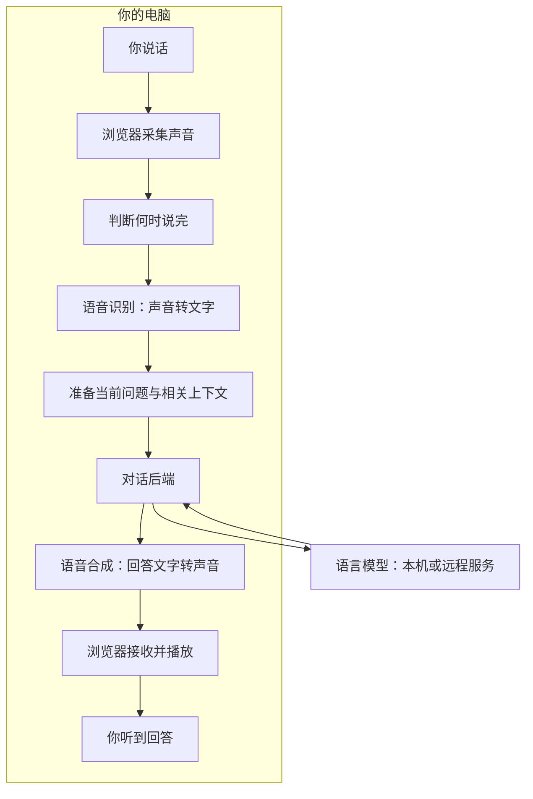
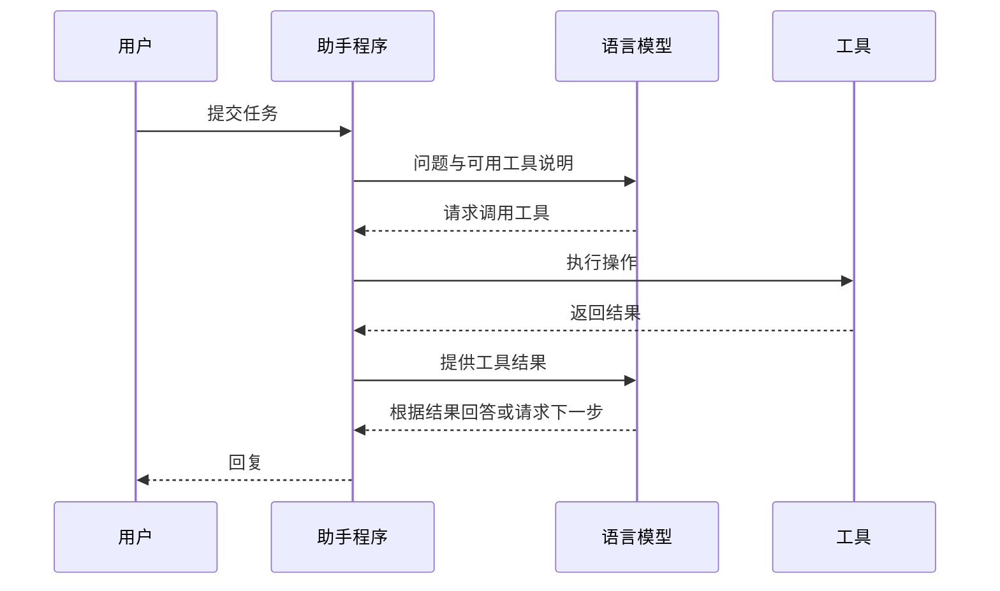

# M00.01 项目到底解决什么问题

本课目标：用自己的话讲清Deskbot的一次输入怎样变成一次回复，分清用户设备、浏览器、语音服务和语言模型各自做什么。

前置知识：无。本课先用画图和纸面模拟建立认识；M00.02再学习目录、终端与第一个程序。预计可分两次阅读，先理解例子，再完成练习。学完的依据是你能解释和判断，而不只是把文字读完。

## 1 从一件具体的事开始

假设你坐在电脑前，对麦克风说：

> 请简单解释什么是语音助手。

你希望发生的事情是：电脑听见这句话，理解请求，组织回答，再通过扬声器说出来。

这是一个用户需求。“用户”就是使用系统的人，在这个例子里是你；“需求”就是你希望系统帮你完成的事情。

一项需求可以分成三部分：

| 部分 | 这个例子里是什么 |
|---|---|
| 输入 | 你说出的声音 |
| 处理 | 接收声音、判断何时说完、转成文字、生成回答、合成声音 |
| 输出 | 你听到的语音回答 |

声音变成回答，要经过好几个环节。后续学代码，就是逐个看清这些环节如何实现、怎样连接、出错后怎样定位。

“输入—处理—输出”这个方法还可以用来理解每一个小函数：它接收什么，做什么，返回什么。现在先记住这三个问题。

## 2 先认识四个词

### 程序

程序是一组让计算机执行的指令。

例如，一段很小的程序可以按顺序做三件事：接收名字、拼出问候、显示问候。Deskbot包含许多程序指令，用来处理声音、网络消息、模型结果和设备动作。

写在文件中的指令叫源码。运行程序，才会执行对应指令。源码放在GitHub，只说明文件已保存到远程仓库；使用语音助手仍需要启动相应程序。

### 项目

项目是围绕一个目标组织起来的源码、配置、说明文档、测试和其他资源。

Deskbot这个项目包括机器人相关模块，以及电脑上的语音服务、网页和视觉能力。我们当前课程深入学习其中的server/voice，其他部分先学会如何连接和运行。

测试用于检查某个行为是否符合预期。例如，用户打断时，旧回复是否还继续发送。配置用于选择程序运行时的选项，例如使用哪个模型、监听哪个端口。这些词后面都有独立课程。

### 客户端和服务端

客户端发起请求并展示或播放结果；服务端接收请求、处理它，再把结果返回。

在电脑浏览器方案里，你打开的测试网页是客户端的一部分，电脑上的语音服务负责处理对话。接入机器人后，机器人也可以作为客户端上传声音、接收回复。

“客户端”和“服务端”表示分工，不表示一定是两台机器。一个浏览器和一个语音服务可以同时运行在你的电脑上。

### 语言模型

本课所说的语言模型，是能够根据输入文字生成文字结果的模型。常见缩写LLM表示“大语言模型”。

输入“请简单解释什么是语音助手”，模型可能输出“语音助手是一种可以通过说话接收请求并给出回应的软件。”

在本项目中，语言模型接收的文字可以包含当前问题、对话历史和用户偏好。模型可以在本机运行，也可以通过网络访问；项目支持哪条路径由具体配置和可用服务决定。

语音识别与语音合成也可能使用模型。本课先分清：语言模型负责文本处理与生成，声音的接收、转写、合成和播放另有环节。

## 3 一次普通语音问答怎样完成

先看电脑浏览器方案的简化路径：

图中的箭头表示信息往哪个方向流动。本机模型也位于你的电脑，图中把它单独画出是为了展示其职责；远程模型则通过网络访问。

逐步看每一步：

1. **浏览器采集声音。** 浏览器获得麦克风许可后，才能取得你说话的声音数据。浏览器测试桥负责把客户端声音和语音服务连接起来。
2. **判断何时说完。** 系统需要划分一次发言的开始与结束。VAD是语音活动检测的缩写，负责判断音频里是否有说话；手动停止录音也可以结束一次输入。
3. **语音识别。** ASR是自动语音识别的缩写，它把声音转成文字。例如，将录音转写为“请简单解释什么是语音助手”。如果这里认错字，后面的模型可能收到错误的问题。
4. **准备上下文。** 上下文是本次处理问题时能参考的信息，例如刚才说过的话、助手的回答方式，以及从存储中取出的相关偏好。模型能使用哪些历史，需要程序准备并提供。
5. **生成回答。** 对话后端组织这次回答所需的步骤。普通问答可以把文字交给语言模型，再接收它生成的回答。
6. **语音合成。** TTS是文字转语音的缩写，它把回答文字转换为可以播放的声音数据。
7. **发送与播放。** 服务端把声音返回客户端；浏览器接收并播放后，你才真正听见它。

本课先把“对话后端”理解成负责组织回答的程序部分。后面M06、M07会讲它的输入结构、流式输出与工具循环。

图为职责示意。真实浏览器链路中，一部分声音判断发生在浏览器测试桥，一部分处理发生在语音会话；分句、声音编码和播放队列将在M09、M10继续拆解。

## 4 文字输入为什么可以更早用来学习

假设你直接在网页输入：

> 请简单解释什么是语音助手。

系统已经拿到文字，就可以从“准备上下文”开始，进入对话后端。源码支持带文字的输入跳过语音识别。

因此，学习Agent核心时，我们可以先观察文字请求：模型收到什么、返回什么、是否要求调用工具。随后接入语音时，再研究声音识别和播放对交互的影响。

如果输出仍需要朗读，TTS和播放部分仍然要工作。

## 5 让助手采取行动时会增加什么

现在换一个请求：

> 看看我手里拿的是什么。

这个问题需要图像信息。项目的摄像头和视觉能力在配置、连接与权限就绪时，可以完成拍照和分析。

“工具”是程序提供的一项具体操作，例如查询设备状态、拍照或调整音量。工具有输入，也会返回结果。用户说的话、模型提出的工具请求和工具真正执行，是几个不同的步骤。

先用一个通用的模型工具流程理解Agent：

当模型能根据目标选择工具，并根据执行结果决定下一步时，这就体现了Agent的核心机制。真正的操作由程序发起和执行，执行结果为后续判断提供依据。

Deskbot还为明确的拍照、运动和停止请求设置了直接处理路径。这类请求可以由程序规则识别并执行，不一定先让文字模型选择工具。实际的明确观察请求在获得视觉描述后，也可以直接把描述交给语音合成。

因此，读真实代码时要先确定请求走的是哪条路径。当前默认配置使用普通语言模型对话；开启MCP后，可以使用现有摄像头/设备工具后端。MCP是连接和调用工具所用的一类协议，详细格式在M11学习。

现在只需要能说清两个问题：谁提出操作请求，谁执行并拿到结果。

## 6 在真实项目里找到这些分工

下面是本课的源码地图。你可以打开文件观察名称和文字说明；复杂语法留到相应课程精读。路径均相对/home/yyy/desktop/ai/Deskbot/server/voice。

| 文件 | 本课先知道的职责 |
|---|---|
| run.py | 启动语音服务的入口 |
| local_test.py | 启动本地浏览器测试页与桥接服务 |
| src/voice_server/app.py | 组装模型、记忆、语音和工具等组件 |
| src/voice_server/session.py | 处理一轮发言、回答、发送与打断 |
| src/voice_server/dialogue.py | 定义对话后端接收什么、输出什么 |
| src/voice_server/camera_dialogue.py | 处理直接指令，以及模型工具调用循环 |
| src/voice_server/providers/ | 接入语音检测、语音识别、语言模型、语音合成等能力 |
| src/voice_server/memory/ | 保存和取出对话、摘要、偏好等记忆 |
| local_test/ | 浏览器页面、交互和音频处理 |

“入口”表示从哪里启动执行；“组件”表示承担一项职责的程序部分；“接口”表示各部分如何约定输入和输出。后续课程会逐步把这些词落实到代码。

local_test.py启动网页与桥接，run.py启动语音服务。完整浏览器对话需要相应后端和模型能力可用。只打开网页文件或只启动测试页，并不自动完成全部对话处理。

## 7 本课的动手任务

本课先做纸面模拟，在纸、记事本或聊天回复里完成即可。

**任务A：画出普通问答。**

从“用户说话”画到“用户听到回答”，标出：

- 哪部分接触麦克风和扬声器；
- 哪部分接收和处理对话请求；
- 哪部分把声音变成文字；
- 哪部分生成回答文字；
- 哪部分把回答文字变成声音。

给电脑内的部分标“电脑”；给模型标“本机或远程”；另画一个小框，表示以后可以用机器人替换浏览器作为客户端。

**任务B：改变输入。**

把“用户说话”换成“用户直接输入文字”。在图上划掉这次可以跳过的步骤，保留仍需语音播放的步骤。用一句话解释原因。

**任务C：观察故障。**

假设网页已经显示正确转写和正确回答，但你听不到声音。请说出接下来值得检查的环节，并说明现有现象已经证明了哪部分成功。

这个练习先训练按数据流定位范围。没有额外日志时，不需要猜定是哪一行代码出错。

## 8 理解检查

用自己的话回答下面三个问题：

1. 浏览器、语音服务、语言模型分别负责什么？
2. 直接输入文字并要求朗读，通常可以跳过哪个环节？还需要哪些环节？
3. 助手显示“已经拍照”，怎样的信息能帮助你确认拍照真的执行过？

可以先写不完整的答案。讲解AI应根据你的回答找到具体缺口，再补解释；没有提交回答或完成练习时，本课保持“未学”。

参考答案另存为[M00.01-answers.md](M00.01-answers.md)。先独立回答，再对照。

## 9 验收与下一步

本课通过需要两类证据：一张职责基本正确的流程图，以及对上面三个问题的独立解释。能清楚说明语言模型是整个应用的一部分、工具实际执行需要程序和结果，就达到本课目标。

通过后进入M00.02：找到项目文件，认识路径和终端，亲手运行第一个小程序。后续每课都采用概念、实验、源码、练习、讲回的方式推进。

## 本课源码依据与阅读记录

核对日期：2026-11-26。

- README.md、docs/voice-agent-integration.md：链路与模块用途；具体能力继续以源码核对。
- local_test.py::main：启动测试桥，提示另行启动run.py。
- src/voice_server/dialogue.py::TurnRequest、DialogueBackend、LLMDialogueBackend：对话后端边界与普通模型路径。
- src/voice_server/app.py::ServerApplication.from_config：创建Provider、记忆和可选MCP后端。
- src/voice_server/session.py::_run_pipeline：文本输入可跳过ASR，之后组装上下文并生成回复。
- src/voice_server/camera_dialogue.py::stream：明确请求的直接路径，以及模型工具循环。

本课只建立职责与数据流认识；以上文件的完整函数、语法和失败分支仍待M02–M12各课精读，不能记为已经全部学完。
