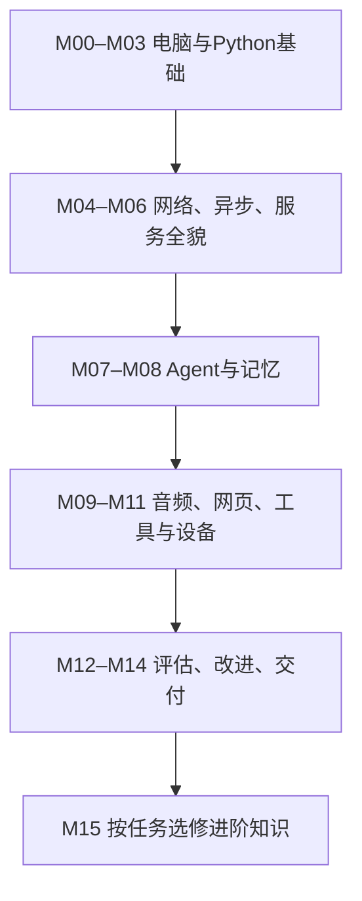

# Deskbot 零基础到 Agent 开发课程大纲

核对日期：2026-11-26。对象：完全零基础学习者；求职方向为深圳 Agent / 大模型应用相关岗位。课程以掌握项目、独立开发、逐步改进为目标，按能力验收推进。

## 已确认的需求和学习范围

- 从文件、终端、变量、函数开始讲；不因过去读过章节或AI写过代码而假定已经掌握。
- 深入 `/home/yyy/desktop/ai/Deskbot/server/voice` 的全部自有源码：Python服务、网页、脚本、测试、配置与部署样例。第三方库讲调用契约、数据格式和本项目相关机制；不把所有依赖库、神经网络训练实现逐行阅读设为主线前置。
- Deskbot其他模块讲清接口、运行方式、实际连接关系：固件、独立视觉服务、协议目录、设备/机械边界。完整C/C++驱动、焊接和机械设计不纳入深读主线。
- 先独立电脑离线实验，再电脑真实模型/浏览器，最后接机器人。浏览器测试页是桥接入口，需要语音服务；它本身不是无需模型的完整离线Agent。
- 当前整套代码来自AI生成。课程通过独立小实现、源码走读、故障定位、真实改进与前后测量，把项目转为学习者能负责的工程作品。
- 本轮交付课程设计与扩写依据，不预生成85课教材。其他AI按每课规格逐课扩写，实验运行与学生验收随后发生。

## 四份文件怎么使用

| 文件 | 读者与用途 |
|---|---|
| [本课程大纲](syllabus.md) | 学生看路线；编写AI按课号、知识点、实验、验收扩写 |
| [源码覆盖地图](source-map.md) | 查每个项目文件在哪学、配哪类测试，避免漏模块 |
| [当前差距与改进路线](improvement-roadmap.md) | 区分已有能力、待测体验和拟新增能力；作为M12/M13任务来源 |
| [给其他AI的教材编写说明](ai-authoring-guide.md) | 统一零基础讲解深度、逐课输出格式、验收与交接方式 |

课程仓库：`/mnt/study/github/agentic-ai-system-course`。练习与生成教材放在 `workspace/deskbot-learning/`；现有 `course/` 与 `references/` 保持只读。Git跟踪此目录中的四份课程设计文件：syllabus.md、source-map.md、improvement-roadmap.md、ai-authoring-guide.md；后续教材、练习和进度默认保留在本地，需要时另行选择同步范围。

## 完成课程意味着什么

“掌握完整项目”以以下能力证明：

1. 从启动入口出发，讲清配置、对象创建、监听器、会话、模型、工具、记忆、音频和网页之间的实际调用关系。
2. 对每个自有源码文件，说明职责、重要函数、输入输出、状态归属、调用者、失败处理、验证方式；小模块逐行讲，大模块按真实执行路径分课读完。
3. 独立写一个最小文本Agent：构造消息、接收工具请求、执行工具、回传结果、结束或报告失败。
4. 独立补一个简单工具或Provider，并解释为什么接口这样设计；能修一个普通可复现问题。
5. 能在电脑运行完整浏览器演示；有硬件时完成实机接入与验收，缺硬件时明确哪些结论只在模拟环境成立。
6. 对自己的改进报告基线、样本、判定规则、改后结果和代价，能够回答代码与设计追问。

按这些标准评估“会不会”，不按读完课数、代码行数或AI生成速度评估。课程覆盖项目开发所需基础；实际岗位还有学历、经历和基础编程考核等独立要求。

## 主线的五个阶段

- **M00–M03产物：** 一个能读配置、处理文本、带少量测试的本地命令助手。
- **M04–M06产物：** 可追踪的fake语音会话，能解释网络、状态与取消。
- **M07–M08产物：** 有工具循环和临时SQLite记忆的文字Agent，附独立实现证据。
- **M09–M11产物：** 可运行的电脑浏览器语音助手，外部模块接口图。
- **M12–M14产物：** 固定评估集、至少一项实际改进、复现说明、演示与复盘。
- **M15：** 为遇到的新任务补能力，选修不阻塞主线验收。

改进贯穿学习过程：M07可以先完成文字调试入口，M08建立记忆更正案例，M09记录语音各阶段耗时，M10改善一个可定位的网页交互问题。每次先用已学的测试方法留最小基线，再做一个小改动。M12把这些零散证据整理成统一评估，M13集中完成较完整的改进；不要求等85课全部结束才改项目。

每课围绕一个问题，通常拆成“概念/最小实验”和“真实代码/练习/验收”两次学习也可以。学习时间尚未确定，因此不承诺几周学完；先完成M00前两课，再根据实际独立操作情况调整节奏。

## 每课的统一要求

以下不是只列术语的目录。每一课扩写时必须包含：

1. 当前问题及其在Deskbot中的用途；前置知识检查，缺项先补短桥接课。
2. 新术语中文定义、必要英文、直观例子；第一次出现的语法逐行解释。
3. 最小可运行实验：完整文件、运行目录、命令、预期输出、一个可预测变化。
4. 真实源码走读：入口、数据、函数、状态、返回、异常；明确当前实现与改进提案。
5. 一个小改动或故障练习；分层提示和分开的参考答案。
6. 学生讲回及独立实现/定位验收；记录证据与未懂点，不能替学生宣布已掌握。

真实源码中的新语法第一次出现时必须讲清。示例：装饰器、类型标注、正则、推导式、lambda、解包、bytes、await、yield、上下文管理、JS Promise，均有对应主课；剩余小语法在所属课补充，不能只说“这是标准写法”。

## 课程总表

| 模块 | 课数 | 结束时能做什么 |
|---|---:|---|
| M00 从零认识电脑、程序与项目 | 4 | 能找到文件、说明程序如何运行，并安全地完成第一个本地练习。 |
| M01 用Deskbot小例子学习Python基本语法 | 7 | 独立写函数处理文本和消息字典。 |
| M02 读懂多文件Python工程 | 6 | 读懂项目的类、接口、异常、导入与测试结构。 |
| M03 文件、数据表示与配置 | 4 | 能解释配置从哪里来、消息如何编码、程序如何找到资源。 |
| M04 从本机通信学HTTP与WebSocket | 5 | 能分清地址、请求、长连接和应用协议，定位常见连通性问题。 |
| M05 异步、流式、队列与取消 | 6 | 真正读懂await、yield、后台任务及语音打断，不把并发当成玄学。 |
| M06 完整追踪服务启动与一轮对话 | 5 | 能从入口走到输出，理解对象、状态、任务与资源生命周期。 |
| M07 从模型调用到可解释的Agent循环 | 7 | 能独立实现并讲解一个受限工具型agent，理解现有后端的实际行为。 |
| M08 SQLite、短期上下文与长期记忆 | 6 | 读懂全部记忆代码，能够区分存储、召回、摘要、事实和删除语义。 |
| M09 读懂完整音频链路 | 7 | 理解每个语音Provider及音频工具，并能定位声音链路问题。 |
| M10 网页测试台与浏览器音频 | 6 | 读懂本地网页全部自有代码，独立定位前后端交互和播放问题。 |
| M11 MCP、视觉、设备工具与管理接口 | 7 | 理解所有外部能力如何连接，以及项目边界外的模块如何配合。 |
| M12 测试、评估、日志与性能证据 | 6 | 能区别代码正确性与智能体任务质量，建立可重复的比较方法。 |
| M13 边学边改的项目实践 | 5 | 完成能自己解释的真实改进，并保留前后证据。 |
| M14 独立维护、交付与求职表达 | 4 | 形成可复现作品，能够现场讲解、修复和扩展。 |
| M15 掌握主线后的Agent进阶选修 | 5（选修） | 建立进一步学习地图，能判断何时需要增加能力。 |

主线M00–M14共85课；M15进阶选修5课，共90个可独立扩写的课题。课号如M07.04，保持稳定；桥接微课可标M07.04-B1，不自动改变后续编号。

## M00 从零认识电脑、程序与项目

**前置：** 无；默认没用过终端、没写过程序。

**模块目标：** 能找到文件、说明程序如何运行，并安全地完成第一个本地练习。

### M00.01 项目到底解决什么问题

- **前置检查：** 本模块前置要求已满足。
- **必须讲清：** 用户、需求、输入、处理、输出；程序、服务端、浏览器、设备、模型的区别；现有能力与计划能力。
- **源码与材料：** Deskbot/README.md；README.md；docs/voice-agent-integration.md
- **动手任务：** 画用户说话到回复的流程图，用颜色标出电脑、浏览器、机器人所在位置。
- **验收证据：** 用自己的话描述一次请求；能指出LLM与整个应用不是同一个对象。

### M00.02 文件、目录与终端

- **前置检查：** M00.01已验收；必要时回看本模块前置。
- **必须讲清：** 文件扩展名、纯文本、源码、绝对/相对路径、当前目录；编辑器和终端；命令、参数、标准输入输出、退出码。
- **源码与材料：** run.py；local_test.py（仅看文件与入口，不要求读懂语法）
- **动手任务：** 在课程exercises目录新建并运行hello.py；比较不同当前目录下的相对路径。
- **验收证据：** 独立找到目标目录、运行脚本、解释找不到文件的错误；不会把命令写进Python文件。

### M00.03 Python解释器与依赖环境

- **前置检查：** M00.02已验收；必要时回看本模块前置。
- **必须讲清：** 解释执行、Python版本、包、pip、虚拟环境、PATH、import路径；系统环境与项目环境；本地进程和远程API。
- **源码与材料：** requirements.txt；requirements-test.txt；requirements-dev.txt；run.py
- **动手任务：** 只读核查现有Python和venv路径；在独立学习环境运行标准库实验。安装前解释目标环境和用途。
- **验收证据：** 能说清本次用哪个Python、包安装到哪里、为什么先不下载所有模型。

### M00.04 用实验而非复制判断学会

- **前置检查：** M00.03已验收；必要时回看本模块前置。
- **必须讲清：** 预测、运行、观察、解释、修改；报错与预期失败；Git仓库、diff、提交的最小含义；真实数据与练习数据。
- **源码与材料：** pytest.ini；tests/fakes.py（概念预览）；课程ai-authoring-guide.md
- **动手任务：** 让hello.py按名字输出问候，再故意制造一个拼写错误并定位；建立个人进度条目。
- **验收证据：** 不看答案改一行并解释前后行为；把不懂的词记录为下一课前置。

## M01 用Deskbot小例子学习Python基本语法

**前置：** M00全部验收；本模块按课号顺序。

**模块目标：** 独立写函数处理文本和消息字典。

语法核对使用与项目环境一致的 [Python 3.11 教程](https://docs.python.org/3.11/tutorial/index.html)。教材仍需从编程零基础解释，不把官方参考手册直接当授课全文。

### M01.01 值、变量与基本类型

- **前置检查：** 本模块前置要求已满足。
- **必须讲清：** 赋值、表达式、整数、小数、字符串、布尔、None、print、type；变量名与字符串内容的区别。
- **源码与材料：** config.example.yaml中的简单值（只读数据）；未来对应config.py
- **动手任务：** 用变量表示设备名、音量、是否在线；打印一条设备说明。
- **验收证据：** 预测类型和输出，解释字符串'20'与整数20的差别。

### M01.02 字符串与用户输入

- **前置检查：** M01.01已验收；必要时回看本模块前置。
- **必须讲清：** 索引、切片、长度、拼接、f-string、strip、lower、包含关系；input得到字符串；中文与字符。
- **源码与材料：** session.py::extract_music_query（先给删减版）
- **动手任务：** 把带空格的用户文本整理成一条干净请求；识别空输入。
- **验收证据：** 独立处理前后空格和空字符串，并解释每一步输入输出。

### M01.03 判断与分支

- **前置检查：** M01.02已验收；必要时回看本模块前置。
- **必须讲清：** if/elif/else、比较、and/or/not、真值、缩进、提前return的预告。
- **源码与材料：** protocol/state.py中的状态名称；camera_dialogue.py直接命令的简化例子
- **动手任务：** 对'停止'、'查询'、普通聊天做三个确定性分支。
- **验收证据：** 能预测每条输入进入哪个分支；说明这种规则判断与模型决策的区别。

### M01.04 列表、元组、字典与集合

- **前置检查：** M01.03已验收；必要时回看本模块前置。
- **必须讲清：** 容器、键值、索引、get、append、成员判断；可变性、对象引用、浅拷贝的直观示例。
- **源码与材料：** dialogue.py::TurnRequest.messages；providers/openai_compatible.py中的messages示例
- **动手任务：** 手工构造system/user/assistant三条消息，修改副本并观察原列表。
- **验收证据：** 独立取出最后一条用户消息；解释列表与字典各承担什么。

### M01.05 循环与计数

- **前置检查：** M01.04已验收；必要时回看本模块前置。
- **必须讲清：** for、while、range、enumerate、break、continue；循环条件、累计、常见越界；列表推导式先展开再压缩；sorted/key、lambda、any/all、生成式在首次出现时拆成普通循环。
- **源码与材料：** camera_dialogue.py::stream中的round_index循环（简化）；audio/sentences.py
- **动手任务：** 遍历消息统计用户发言条数；写有三次上限的模拟工具循环。
- **验收证据：** 解释循环何时停止；能把简单推导式改成普通for。

### M01.06 函数、参数与返回值

- **前置检查：** M01.05已验收；必要时回看本模块前置。
- **必须讲清：** def、位置/关键字参数、默认参数、return、作用域；输入输出契约；函数对象与函数调用。
- **源码与材料：** session.py::extract_music_query；camera_dialogue.py::_model_tool_name
- **动手任务：** 独立写normalize_text、make_message两个函数，并用断言验证。
- **验收证据：** 不靠复制写函数；能区分print和return，定位参数名不一致的问题。

### M01.07 把基础组合成文本助手

- **前置检查：** M01.06已验收；必要时回看本模块前置。
- **必须讲清：** 组合调用、简单工具注册字典、查找函数、固定规则与工具结果；基础时间/空间成本以列表扫描为例。
- **源码与材料：** 已有workspace/01-tool-call-lifecycle.py作为补充；真实LLM暂不调用
- **动手任务：** 完成一个只用标准库的文本命令助手：查询模拟状态、设置模拟音量、退出。
- **验收证据：** 能从空文件重写主流程并添加一个只读工具；说明当前还没有模型。

## M02 读懂多文件Python工程

**前置：** M01；不预设面向对象、类型标注或测试经验。

**模块目标：** 读懂项目的类、接口、异常、导入与测试结构。

### M02.01 模块、包与程序入口

- **前置检查：** 本模块前置要求已满足。
- **必须讲清：** import/from、模块查找、包与__init__.py、__name__、main函数、python -m、sys.path。
- **源码与材料：** run.py；src/voice_server/__main__.py；src/voice_server/__init__.py
- **动手任务：** 把上一模块助手分成tools.py与main.py，分别直接运行和模块运行。
- **验收证据：** 画出从run.py到main的导入路径，解释相对目录导致导入失败的原因。

### M02.02 类、对象与实例状态

- **前置检查：** M02.01已验收；必要时回看本模块前置。
- **必须讲清：** class、__init__、self、方法、属性、组合、实例与类；两个实例隔离；继承只讲项目实际用法。
- **源码与材料：** protocol/state.py::SessionStateMachine；dialogue.py::LLMDialogueBackend
- **动手任务：** 创建两个Device对象，分别改变状态。
- **验收证据：** 解释self是谁；能证明一个设备的状态不会自动改另一个。

### M02.03 dataclass、Enum与类型标注

- **前置检查：** M02.02已验收；必要时回看本模块前置。
- **必须讲清：** 装饰器的调用含义、dataclass、frozen、field/default_factory；Enum；list[dict]、|None、Any、Callable、TypeVar；classmethod/staticmethod/property及可变对象字段。
- **源码与材料：** dialogue.py::TurnRequest；config.py配置类；memory/models.py；protocol/state.py
- **动手任务：** 创建TurnRequest的小型版本；把字符串状态改成Enum；观察可变默认值问题。
- **验收证据：** 读懂一个真实函数签名；说明类型标注不自动等于运行时校验，frozen不是深冻结。

### M02.04 Protocol与可替换组件

- **前置检查：** M02.03已验收；必要时回看本模块前置。
- **必须讲清：** 接口契约、结构化类型、依赖注入；Provider与Backend各自职责；组合优先从实物替换理解。
- **源码与材料：** providers/base.py；dialogue.py::DialogueBackend；tests/fakes.py
- **动手任务：** 给同一个调用方注入两个不同FakeLLM，保持接口相同。
- **验收证据：** 更换组件不改调用方；能说明哪些方法/返回值必须一致。

### M02.05 异常、资源与上下文管理

- **前置检查：** M02.04已验收；必要时回看本模块前置。
- **必须讲清：** try/except/else/finally、raise、异常链、with、关闭文件/连接；getattr/hasattr/isinstance等实际源码用法；解包*args/**kwargs、字典合并、:=在真实代码出现前逐一补微课。
- **源码与材料：** compat.py；providers/openai_compatible.py::close；audio/transcoder.py
- **动手任务：** 模拟工具失败，并保证文件或模拟连接在正常与失败时都关闭。
- **验收证据：** 能定位异常传播路径；区分向用户说明失败与吞掉错误。

### M02.06 第一次读测试与调试

- **前置检查：** M02.05已验收；必要时回看本模块前置。
- **必须讲清：** assert、pytest用例、fixture、tmp_path、monkeypatch、fake/stub、失败堆栈、断点与日志；测试不等于真实模型评价。
- **源码与材料：** tests/protocol/test_state.py；tests/test_config.py；tests/fakes.py
- **动手任务：** 给自己的状态对象写正常迁移和无效迁移两个测试，故意改坏再修复。
- **验收证据：** 说明失败断言证明了什么；自己复现一个错误并验证修复。

## M03 文件、数据表示与配置

**前置：** M02；涉及字节时从编码基础讲起。

**模块目标：** 能解释配置从哪里来、消息如何编码、程序如何找到资源。

### M03.01 文本、字节与序列化

- **前置检查：** 本模块前置要求已满足。
- **必须讲清：** Unicode、UTF-8、str/bytes、encode/decode、JSON对象与Python字典、json.dumps/loads；二进制不是乱码文本。
- **源码与材料：** protocol/messages.py；camera_dialogue.py::_text；environment.py
- **动手任务：** 往返编码中文JSON，再比较字节长度与字符长度；观察错误JSON。
- **验收证据：** 能指出网络发送的是字节，能区分数据解析错误与业务参数错误。

### M03.02 文件路径与结构化配置

- **前置检查：** M03.01已验收；必要时回看本模块前置。
- **必须讲清：** pathlib、读写文件、相对路径基准、YAML缩进/类型、JSON与YAML用途、dataclass配置。
- **源码与材料：** config.py；config.example.yaml；tests/test_config.py
- **动手任务：** 用独立临时YAML配置改变模拟助手名称和端口，不编辑真实config.yaml。
- **验收证据：** 画出文件到配置对象的转换；解释路径相对哪个目录。

### M03.03 环境变量与配置优先级

- **前置检查：** M03.02已验收；必要时回看本模块前置。
- **必须讲清：** os.environ、dotenv、环境变量字符串、类型转换、优先级、默认值；密钥值与配置名的区别。
- **源码与材料：** environment.py；config.py::load_config；.env.example；tests/test_environment.py
- **动手任务：** 用无敏感内容的测试变量证明系统环境、env文件、YAML和默认值的覆盖关系。
- **验收证据：** 独立定位一个配置没生效的原因；输出仅包含必要非敏感信息。

### M03.04 命令行、日志与兼容性

- **前置检查：** M03.03已验收；必要时回看本模块前置。
- **必须讲清：** argparse、--help、退出码、logging级别、标准输出/错误、Python版本兼容；包依赖与系统库的区别。
- **源码与材料：** __main__.py；logging_utils.py；compat.py；requirements*.txt
- **动手任务：** 给模拟助手加--config和日志等级；比较合法/非法配置的退出码。
- **验收证据：** 能解释入口失败原因；知道Opus/FFmpeg不只是Python包。

## M04 从本机通信学HTTP与WebSocket

**前置：** M03。先用现成隔离示例观察网络行为；完整aiohttp异步代码在M05后回读，教师需明确标注暂缓的语法。

**模块目标：** 能分清地址、请求、长连接和应用协议，定位常见连通性问题。

网络接口概念可核对 [MDN WebSocket API](https://developer.mozilla.org/en-US/docs/Web/API/WebSockets_API)；项目协议以实际消息解析器和测试为准。

### M04.01 客户端、服务器与端口

- **前置检查：** 本模块前置要求已满足。
- **必须讲清：** 进程、IP、localhost、局域网、端口、监听地址、URL、DNS概念；0.0.0.0监听与可访问地址。
- **源码与材料：** config.py::ServerConfig/LocalTestConfig/AdminApiConfig；server/voice/README.md
- **动手任务：** 在纸上标出8000/8003/8004/8006各谁连接谁；只读查看已有监听，不启停已有服务。
- **验收证据：** 能解释机器人上的127.0.0.1为什么不是电脑。

### M04.02 一次HTTP请求和响应

- **前置检查：** M04.01已验收；必要时回看本模块前置。
- **必须讲清：** GET/POST、路径、query、header、body、JSON、status、timeout；HTTP与HTTPS、认证凭证的用途。
- **源码与材料：** ota.py；admin_api.py；tests/http/test_ota.py
- **动手任务：** 在隔离测试进程请求一个最小/health接口，改变路径和方法观察响应。
- **验收证据：** 能拆解请求响应并区分连接失败、404、业务失败。

### M04.03 WebSocket为什么适合语音

- **前置检查：** M04.02已验收；必要时回看本模块前置。
- **必须讲清：** 握手、长连接、双向消息、文本帧/二进制帧、关闭；HTTP与WebSocket职责区别。
- **源码与材料：** websocket_server.py；protocol/messages.py；tests/test_websocket_server.py
- **动手任务：** 使用fake客户端和隔离WebSocket回声服务交换JSON与bytes。
- **验收证据：** 能解释同一个连接中控制消息和音频包如何区分。

### M04.04 应用协议、会话和关联ID

- **前置检查：** M04.03已验收；必要时回看本模块前置。
- **必须讲清：** hello/listen/abort/stt/tts、device_id/session_id/turn_id、请求响应关联；小智协议与根目录协议草案的区别。
- **源码与材料：** protocol/messages.py；device_mcp.py；Deskbot/protocol/README.md（比较范围）
- **动手任务：** 按测试构造hello→listen→stop消息；画一个错误顺序。
- **验收证据：** 能解释连接身份与设备身份为什么不能混用；不把两套协议拼成一套。

### M04.05 连接问题的分层定位

- **前置检查：** M04.04已验收；必要时回看本模块前置。
- **必须讲清：** 服务是否启动、地址端口、握手、鉴权、数据格式；浏览器跨域/Origin先解释意义；超时、断开、重连。
- **源码与材料：** auth.py；websocket_server.py；local_test.py；docs/local-testing.md
- **动手任务：** 让隔离演示分别出现错误端口、错误消息、连接关闭，根据证据定位层次。
- **验收证据：** 给出最小复现与检查顺序；知道测试网页启动不等于语音后端已启动。

## M05 异步、流式、队列与取消

**前置：** M02函数/异常/接口，M04通信概念。

**模块目标：** 真正读懂await、yield、后台任务及语音打断，不把并发当成玄学。

协程、Task、取消、超时、线程调用语义核对 [Python 3.11 asyncio 官方文档](https://docs.python.org/3.11/library/asyncio-task.html)，不要直接套用更新版本才提供的API。

### M05.01 同步、异步与事件循环

- **前置检查：** 本模块前置要求已满足。
- **必须讲清：** CPU计算与I/O等待、阻塞、协程、async def、await、asyncio.run；并发和并行的区别。
- **源码与材料：** __main__.py::run_application；providers/base.py
- **动手任务：** 两个模拟网络请求先顺序再并发运行，画时间线。
- **验收证据：** 预测输出顺序和耗时；解释await为何不等于新建线程。

### M05.02 Task、Future与共享状态

- **前置检查：** M05.01已验收；必要时回看本模块前置。
- **必须讲清：** create_task、Future、任务引用、等待结果、局部/实例状态、竞态；事件驱动处理。
- **源码与材料：** session.py::_start_pipeline；device_mcp.py；app.py
- **动手任务：** 让两个任务访问同一模拟设备并观察顺序，修正共享变量放置位置。
- **验收证据：** 能指出任务在哪里开始、谁等待它、数据归谁所有。

### M05.03 迭代器、生成器与流式输出

- **前置检查：** M05.02已验收；必要时回看本模块前置。
- **必须讲清：** iter/next、yield、生成器暂停恢复、async for、AsyncIterator、anext、结束信号、aclosing。
- **源码与材料：** providers/openai_compatible.py::stream；dialogue.py::stream；session.py::_response_sentences
- **动手任务：** 把完整字符串分块逐次产出，对比一次性返回。
- **验收证据：** 解释一个chunk不等于一句话；能画出消费者取下一块时的控制流。

### M05.04 队列、背压与流水线

- **前置检查：** M05.03已验收；必要时回看本模块前置。
- **必须讲清：** 生产者消费者、有界Queue、put/get、预取、队列满后等待、内存与延迟取舍；Semaphore/Lock用途。
- **源码与材料：** session.py::_response_sentences/_response_audio；providers/sensevoice.py
- **动手任务：** 快生产慢消费实验，比较无界与小容量队列。
- **验收证据：** 说明为什么限制排队比一味加并发更适合语音播放。

### M05.05 取消、超时与资源清理

- **前置检查：** M05.04已验收；必要时回看本模块前置。
- **必须讲清：** cancel、CancelledError、finally、timeout、关闭迭代器、旧结果作废；超时等待与任务实际停止的区别。
- **源码与材料：** session.py::abort/_cancel_pipeline；compat.py；tests/session/test_abort.py
- **动手任务：** 中途取消模拟流，保证旧chunk不再显示，并用测试证明。
- **验收证据：** 解释用户打断后哪些任务停止、哪些外部动作已无法撤回。

### M05.06 线程、子进程与阻塞边界

- **前置检查：** M05.05已验收；必要时回看本模块前置。
- **必须讲清：** to_thread、线程池、同步推理、进程、stdin/stdout/stderr、subprocess、事件循环延迟；线程取消的实际边界。
- **源码与材料：** providers/sensevoice.py；providers/silero.py；audio/transcoder.py；providers/local_tts.py
- **动手任务：** 用短同步任务比较直接调用与to_thread；用标准库子进程回显数据并回收。
- **验收证据：** 能指出真实源码中的阻塞边界；先测影响再决定是否改实现。

## M06 完整追踪服务启动与一轮对话

**前置：** M00–M05；模型、记忆、音频先用fake，内部算法后续学习。

**模块目标：** 能从入口走到输出，理解对象、状态、任务与资源生命周期。

### M06.01 应用组装与依赖注入

- **前置检查：** 本模块前置要求已满足。
- **必须讲清：** 配置到Provider实例、后端选择、对象依赖图、工厂方法、资源所有权。
- **源码与材料：** app.py::ServerApplication.from_config；dialogue.py；tests/test_app.py
- **动手任务：** 用fake画出并组装最小application，说明传入自定义backend后改变了什么。
- **验收证据：** 逐一说出ASR/LLM/TTS/memory/backend由谁创建、谁共享、谁关闭。

### M06.02 监听器启动与关闭

- **前置检查：** M06.01已验收；必要时回看本模块前置。
- **必须讲清：** 启动顺序、成功/失败、ready状态、finally停止、并发停止与锁；进程生命周期。
- **源码与材料：** app.py::start/stop；__main__.py；tests/test_app.py
- **动手任务：** 让第二个fake监听器启动失败，观察已启动资源回收；不触碰运行中的正式服务。
- **验收证据：** 能解释/health与/readyz的证据范围，并追踪失败后清理。

### M06.03 连接变成会话

- **前置检查：** M06.02已验收；必要时回看本模块前置。
- **必须讲清：** hello校验、设备身份、会话创建、连接限额、每设备会话、codec/VAD的实例隔离。
- **源码与材料：** websocket_server.py；session.py::__init__；tests/session/test_isolation.py
- **动手任务：** 建立两个隔离fake会话，分别提交消息并检查历史与状态。
- **验收证据：** 解释共享模型与独立会话的边界；能画出连接关闭的清理路径。

### M06.04 一轮文本到语音的主流程

- **前置检查：** M06.03已验收；必要时回看本模块前置。
- **必须讲清：** 状态迁移、generation、TurnRequest、记忆命令/点歌/普通对话分支、保存用户与assistant消息。
- **源码与材料：** session.py::_run_pipeline/_make_messages；protocol/state.py；tests/session/test_manual_turn.py
- **动手任务：** 用fake把一条detect.text输入追踪到TTS包；为流程节点写输入输出表。
- **验收证据：** 不看架构图复述路径；说明文本输入跳过哪一步、哪些分支绕过后端。

### M06.05 失败、打断和部分回复

- **前置检查：** M06.04已验收；必要时回看本模块前置。
- **必须讲清：** 阶段错误定位、错误播报、已发送内容保存、旧回合失效、连接断开；用户听到与服务器发出的区别。
- **源码与材料：** session.py::_run_pipeline/abort/_send_json/_send_bytes；tests/session/test_abort.py；tests/session/test_limits.py
- **动手任务：** 分别模拟LLM失败、TTS失败、用户打断，比较最终状态和持久消息。
- **验收证据：** 每个情形能说明已经发生的效果、未完成部分和可恢复入口。

## M07 从模型调用到可解释的Agent循环

**前置：** M06；Python函数/JSON/异步流已验收。课程对应Ch.01–04、09、11。

**模块目标：** 能独立实现并讲解一个受限工具型agent，理解现有后端的实际行为。

课程原理对应 [Ch.01 工具调用](../../course/zh/01-function-calling.md)、[Ch.02 循环](../../course/zh/02-the-agent-loop.md)、[Ch.03 工具契约](../../course/zh/03-tools-validation.md)、[Ch.04 上下文](../../course/zh/04-prompts-context-cache.md)。从简单API与可组合机制理解Agent，也可对照 [Anthropic的工程说明](https://www.anthropic.com/research/building-effective-agents)。

### M07.01 语言模型如何参与软件

- **前置检查：** 本模块前置要求已满足。
- **必须讲清：** LLM输入输出、token、上下文窗口、模型参数与API参数、推理与训练、温度与输出长度、能力错误与程序错误；概率从直觉讲。
- **源码与材料：** providers/openai_compatible.py::__init__/stream；config.py::LlmConfig
- **动手任务：** 用FakeLLM观察同一messages的响应；若使用真实API，先明确模型、费用和最小请求。
- **验收证据：** 能解释模型既不会自动执行Python，也不会自动记住所有往轮。

### M07.02 消息、提示词与上下文组装

- **前置检查：** M07.01已验收；必要时回看本模块前置。
- **必须讲清：** system/user/assistant/tool角色、指令与数据、系统提示、历史、长度预算、提示与程序约束。
- **源码与材料：** dialogue.py::DEFAULT_SYSTEM_PROMPT；session.py::_make_messages；camera_dialogue.py::stream
- **动手任务：** 打印一条无敏感信息的完整模拟请求，分别移除历史与系统提示并比较行为。
- **验收证据：** 指出每段上下文来源；区分修改提示词与修改执行逻辑的效果。

### M07.03 从服务响应读流式文本

- **前置检查：** M07.02已验收；必要时回看本模块前置。
- **必须讲清：** SDK对象、客户端、chat completions兼容接口、delta拼接、结束/异常、客户端关闭；本项目实现与其他API形状区别。
- **源码与材料：** providers/openai_compatible.py::stream/stream_with_tools；tests/providers/test_openai_compatible.py
- **动手任务：** 用模拟chunk拼回中文文本与工具参数，含分块边界。
- **验收证据：** 解释为什么不能把每个chunk当完整JSON或完整tool call。

### M07.04 一次工具调用的四步

- **前置检查：** M07.03已验收；必要时回看本模块前置。
- **必须讲清：** 工具名称/描述/input schema、JSON参数、ToolCall、调度函数、tool_call_id与结果回传；最小参数契约。
- **源码与材料：** providers/openai_compatible.py::ToolCall；camera_dialogue.py::_execute/_execute_impl；课程Ch.01、03
- **动手任务：** 实现get_device_status模拟工具，把请求、执行、结果、回答四步写在终端。
- **验收证据：** 能独立增加只读工具并解释schema与函数参数要一致。

### M07.05 多轮工具循环与终止

- **前置检查：** M07.04已验收；必要时回看本模块前置。
- **必须讲清：** 观察、模型决策、执行、反馈、结束；一轮对话内多次模型请求；轮数上限后的最终回答；串行工具关系。
- **源码与材料：** camera_dialogue.py::stream；tests/test_camera_dialogue.py；课程Ch.02
- **动手任务：** 模拟先查询再回答的两步任务，另模拟达到轮数上限；不执行真实运动。
- **验收证据：** 准确指出成功tool结果如何进入下一次请求，解释已有最终收尾轮。

### M07.06 确定性路径、错误与事实陈述

- **前置检查：** M07.05已验收；必要时回看本模块前置。
- **必须讲清：** 直接指令与模型工具路由、只读/有副作用、成功回执语义、失败回传、澄清问题；跨轮对话指代与本轮工具history区别；正则表达式re.match/search/fullmatch/sub、捕获组和转义先用简单文本例子拆解。
- **源码与材料：** camera_dialogue.py::_direct_camera_tool/_direct_motion_request/_tool_summary/stream
- **动手任务：** 构造普通聊天、明确动作、只读参数错误三类请求；用模拟返回值观察当前失败即结束。
- **验收证据：** 能识别当前行为与拟改行为，说明为什么不盲目自动重试运动。

### M07.07 独立实现最小文本Agent

- **前置检查：** M07.06已验收；必要时回看本模块前置。
- **必须讲清：** Backend契约、可朗读结果与内部事件、工具循环、日志、错误、取消；最小可运行闭环。
- **源码与材料：** dialogue.py；tests/session/test_dialogue_backend.py；课程Ch.11
- **动手任务：** 在exercises实现20–100行起步的无音频FakeAgentBackend，再接一个模拟工具；复杂时分步扩写。
- **验收证据：** 不看现成实现重写核心循环，换工具后仍能完成任务，并讲清输入/状态/结束。

## M08 SQLite、短期上下文与长期记忆

**前置：** M07；从数据库零基础开始。课程对应Ch.04–08。

**模块目标：** 读懂全部记忆代码，能够区分存储、召回、摘要、事实和删除语义。

事务和连接行为核对 [Python 3.11 sqlite3 文档](https://docs.python.org/3.11/library/sqlite3.html)；概念课程对应Ch.05–08，源码召回方式以实际SQL为准。

### M08.01 数据库与SQL从零开始

- **前置检查：** 本模块前置要求已满足。
- **必须讲清：** 表、行、列、主键、SELECT/INSERT/UPDATE/DELETE、WHERE/ORDER/LIMIT、参数化查询、持久化与内存变量；子查询与NOT IN、GROUP BY/MAX在真实查询出现时用小表逐步演算。
- **源码与材料：** memory/sqlite.py建表与基础CRUD；memory/models.py；tests/memory/test_sqlite.py
- **动手任务：** 在临时SQLite库保存三个模拟对话并按设备查询；只操作练习数据库。
- **验收证据：** 独立写一个查询并解释筛选范围；重启程序后仍能读到数据。

### M08.02 记忆数据模型与一致性

- **前置检查：** M08.01已验收；必要时回看本模块前置。
- **必须讲清：** 消息、摘要进度、事实来源、状态、排除项；事务commit/rollback、连接生命周期、锁和并发写的基本含义；INSERT OR IGNORE、ON CONFLICT DO UPDATE怎样处理重复键；时间戳、UTC与本地时区、时间排序。
- **源码与材料：** memory/base.py；memory/models.py；memory/sqlite.py；memory/__init__.py
- **动手任务：** 画出各表的关联，模拟一次失败事务并验证没有部分保存。
- **验收证据：** 解释同一设备事实与来源消息如何关联，区分身份隔离与多用户账户体系。

### M08.03 短期上下文与长度预算

- **前置检查：** M08.02已验收；必要时回看本模块前置。
- **必须讲清：** 近期窗口、当前消息只出现一次、摘要、事实、相关历史；条数/字符/token预算差别、截断顺序。
- **源码与材料：** memory/sqlite.py召回与预算函数；session.py::_make_messages；tests/memory/test_sqlite.py
- **动手任务：** 准备超过窗口的固定对话，逐项列出最终messages与被省略内容。
- **验收证据：** 解释一条旧信息为何没进入模型；能找到当前消息重复问题的检查点。

### M08.04 历史召回与排序

- **前置检查：** M08.03已验收；必要时回看本模块前置。
- **必须讲清：** 关键词、中文二字片段、SQL LIKE、CASE WHEN打分、去重；检索和生成差别；Recall@k、同义表达漏召回。
- **源码与材料：** memory/sqlite.py::_memory_terms及相关历史查询；scripts/benchmark_memory.py
- **动手任务：** 手工标注10条查询的相关历史，测现有词面召回；计算简单Recall@k。
- **验收证据：** 能够算出分母与命中数，并据失败样例判断是否值得加语义检索。

### M08.05 摘要和事实整理的生命周期

- **前置检查：** M08.04已验收；必要时回看本模块前置。
- **必须讲清：** 空闲后台任务、阈值、批次、提示、结构化输出解析、来源、checkpoint、活动取消；摘要不是逐字记录。
- **源码与材料：** memory/service.py；memory/consolidation.py；tests/memory/test_service.py；tests/memory/test_facts.py
- **动手任务：** FakeLLM返回一份摘要和事实，追踪存储与进度；新消息到来时取消整理。
- **验收证据：** 画出触发→读取→生成→保存→推进进度全过程，解释取消后的状态。

### M08.06 记住、纠正、忘掉与重连

- **前置检查：** M08.05已验收；必要时回看本模块前置。
- **必须讲清：** 明确记忆指令、事实更新、过期/遗忘状态、旧内容排除、会话与设备跨连接持久性；逻辑遗忘与物理删除。
- **源码与材料：** memory/service.py::process_command；memory/sqlite.py事实更新/遗忘；admin_api.py记忆接口
- **动手任务：** 固定脚本：记住偏好→纠正→问询→忘掉→再问→换会话；全用合成数据。
- **验收证据：** 每步说明哪些表/上下文改变，验证新会话保持正确；不把记忆持久化叫任务恢复。

## M09 读懂完整音频链路

**前置：** M05异步与字节、M06会话；数学从单位与比例开始。

**模块目标：** 理解每个语音Provider及音频工具，并能定位声音链路问题。

### M09.01 声音如何变成数据

- **前置检查：** 本模块前置要求已满足。
- **必须讲清：** 采样率、位深、声道、PCM、帧、时长、缓冲；Hz/ms/byte换算、16k与24k；压缩编码与容器。
- **源码与材料：** config.py::AudioConfig；audio/opus.py；README音频参数
- **动手任务：** 计算1秒16kHz单声道16bit PCM字节数；用合成短波形验证长度与时长。
- **验收证据：** 独立做单位换算，区分PCM/Opus与文件容器。

### M09.02 Opus编解码与音频边界

- **前置检查：** M09.01已验收；必要时回看本模块前置。
- **必须讲清：** 编码器/解码器、帧大小、输入输出采样率、补齐、bytes缓冲、原生动态库；逐会话codec。
- **源码与材料：** audio/opus.py；audio/__init__.py；tests/audio/test_opus.py
- **动手任务：** 用合成短PCM走编码解码，比较长度与音频属性。
- **验收证据：** 解释有损编码为何不做逐字节相等断言；定位采样率/帧长不一致。

### M09.03 VAD如何决定开始和结束

- **前置检查：** M09.02已验收；必要时回看本模块前置。
- **必须讲清：** 能量直觉、语音概率、阈值、滞后、连续静音时长、噪声/回声、端点检测延迟。
- **源码与材料：** providers/silero.py；session.py::handle_audio；tests/session/test_auto_vad.py；scripts/check_vad_endpoints.py
- **动手任务：** 先用固定真假VAD序列模拟一句话，再可选真实录音测试。
- **验收证据：** 画出何时触发转写，区分识别内容错误与切句过早/过晚。

### M09.04 ASR与模型推理边界

- **前置检查：** M09.03已验收；必要时回看本模块前置。
- **必须讲清：** 完整录音与流式ASR、PCM转数组、归一化、dtype、SenseVoice/FunASR角色、模型加载、线程并发/取消。
- **源码与材料：** providers/sensevoice.py；tests/providers/test_sensevoice.py；scripts/check_asr.py
- **动手任务：** 用fake模型检查数组和转写清洗；有模型时对固定短录音测字符错误及耗时。
- **验收证据：** 解释当前ASR在录音结束后识别；不把模型下载和业务逻辑混为一谈。

### M09.05 回复分句与TTS

- **前置检查：** M09.04已验收；必要时回看本模块前置。
- **必须讲清：** 标点、首短句、最大句长、Unicode文本；TTS请求、音色、流式音频、Edge与本地command。
- **源码与材料：** audio/sentences.py；providers/edge_tts.py；providers/local_tts.py；相应tests
- **动手任务：** 将几种长短文本分句，用fake音频观察首句何时可播放；真实TTS作为后续验证。
- **验收证据：** 解释首句更短为什么可能更快也可能不自然；能实现另一种同接口假TTS。

### M09.06 FFmpeg与流式转码

- **前置检查：** M09.05已验收；必要时回看本模块前置。
- **必须讲清：** 压缩音频→PCM、管道、stdin写入与stdout读取、stderr、进程退出、timeout、取消回收。
- **源码与材料：** audio/transcoder.py；tests/audio/test_transcoder.py；scripts/check_tts.py
- **动手任务：** 用本地合成音频做一次转码，再中途取消并验证子进程回收。
- **验收证据：** 说明两端需要并发读写的原因；分清空输出、格式错误、进程失败。

### M09.07 端到端音频流水线与延迟

- **前置检查：** M09.06已验收；必要时回看本模块前置。
- **必须讲清：** 句子队列、PCM预取、发送节奏、播放时长、背压、首文字/首PCM/首音频/实际首声；AEC/插话分层。
- **源码与材料：** session.py::_response_sentences/_response_audio/_speak_sentence；scripts/benchmark_tts_stages.py；scripts/benchmark_voice_segments.py
- **动手任务：** 画一条模型生成与TTS/发送重叠的时间线，先用fake测阶段时间，再准备真实测量。
- **验收证据：** 解释各指标起止点，定位一个实际慢阶段，区分服务器发送与耳朵听到。

## M10 网页测试台与浏览器音频

**前置：** M04网络、M05异步、M09音频；JavaScript从零讲。

**模块目标：** 读懂本地网页全部自有代码，独立定位前后端交互和播放问题。

音频线程与处理器的接口核对 [MDN AudioWorklet](https://developer.mozilla.org/en-US/docs/Web/API/AudioWorklet)，浏览器实际行为仍要运行验证。

### M10.01 HTML、CSS与网页结构

- **前置检查：** 本模块前置要求已满足。
- **必须讲清：** 标签、属性、DOM、表单、按钮、样式选择器、盒模型、布局；浏览器控制台。
- **源码与材料：** local_test/index.html；local_test/styles.css
- **动手任务：** 在课程独立页面中增加一个模拟设备状态字段并改样式。
- **验收证据：** 能找到元素与样式来源，说明HTML/CSS/JS各自职责。

### M10.02 JavaScript语言与事件

- **前置检查：** M10.01已验收；必要时回看本模块前置。
- **必须讲清：** let/const、类型、对象/数组、函数/箭头函数、作用域、解构、class；事件监听与DOM更新；Map/Set、可选链?.、空值合并??、展开/剩余参数...逐个用简单例子说明。
- **源码与材料：** local_test/app.js的UI与状态处理函数
- **动手任务：** 实现一个连接/断开按钮与事件日志，不连接正式设备。
- **验收证据：** 看懂一个真实事件处理函数，解释点击后数据和UI如何变化。

### M10.03 Promise、fetch与WebSocket客户端

- **前置检查：** M10.02已验收；必要时回看本模块前置。
- **必须讲清：** Promise、async/await、throw/catch/finally、JSON、WebSocket事件、二进制缓冲、关闭与重连。
- **源码与材料：** local_test/app.js网络部分；src/voice_server/local_testing.py路由和桥接
- **动手任务：** 通过隔离测试后端发送文本，观察Network面板与服务端日志。
- **验收证据：** 能沿一条浏览器消息追踪到后端处理，区别前端报错与服务器报错。

### M10.04 麦克风、WebAudio与Worklet

- **前置检查：** M10.03已验收；必要时回看本模块前置。
- **必须讲清：** 权限、getUserMedia、MediaStream、AudioContext、AudioWorklet、Float32Array/Int16Array、重采样/分帧与通道。
- **源码与材料：** local_test/pcm-worklet.js；local_test/app.js采集/播放部分
- **动手任务：** 用合成音频验证分帧，再在用户授权的浏览器录一段短音；观察缓冲大小。
- **验收证据：** 解释为何不能无限保存所有录音帧，以及浏览器采样率不一定等于模型输入。

### M10.05 持续对话、摄像头与打断

- **前置检查：** M10.04已验收；必要时回看本模块前置。
- **必须讲清：** 播放队列、采集保留、回声消除、VAD触发、清空播放、工具摄像头绑定、拍照权限和关闭。
- **源码与材料：** local_testing.py；local_test/app.js；camera_mcp.py；tests/browser/local_test.test.cjs
- **动手任务：** 先用fake事件完成播放中打断与摄像头开关；实测需明确摄像头/麦克风许可。
- **验收证据：** 对照事件顺序解释旧播放为何停止，新一句如何进入后端。

### M10.06 浏览器接真实语音服务

- **前置检查：** M10.05已验收；必要时回看本模块前置。
- **必须讲清：** 网页桥与voice后端分进程、模型与音频依赖、启动前检查、文本先于语音、权限/地址排障。
- **源码与材料：** local_test.py；run.py；docs/local-testing.md；tests/integration/test_local_testing.py
- **动手任务：** 在确认本地环境后依次验证文本→短录音→持续对话；记录配置名称和版本，不记录密钥。
- **验收证据：** 独立完成电脑浏览器演示；定位至少一种实际故障并说明证据。

## M11 MCP、视觉、设备工具与管理接口

**前置：** M07工具循环、M08记忆、M10浏览器；硬件先用模拟设备。课程对应Ch.03、12–14。

**模块目标：** 理解所有外部能力如何连接，以及项目边界外的模块如何配合。

协议角色可对照 [MCP官方架构说明](https://modelcontextprotocol.io/docs/learn/architecture)；新规范与本项目已实现的协议版本要区分，不能默认支持规范中的全部能力。

### M11.01 MCP与JSON-RPC的角色

- **前置检查：** 本模块前置要求已满足。
- **必须讲清：** host/client/server、请求id、method/params/result/error、初始化、能力协商、tools/list与tools/call；MCP与function calling不同层次。
- **源码与材料：** device_mcp.py；camera_mcp.py；camera_dialogue.py::_rpc；相关tests
- **动手任务：** 手工写一次模拟初始化、列工具和调用往返，标注每个id。
- **验收证据：** 能画出LLM工具请求与设备RPC之间的转换，不把MCP当推理算法。

### M11.02 设备工具发现与会话绑定

- **前置检查：** M11.01已验收；必要时回看本模块前置。
- **必须讲清：** 连接通道、pending Future、超时、断开、白名单、工具名映射、参数schema和本地校验。
- **源码与材料：** device_mcp.py；websocket_server.py设备工具方法；camera_dialogue.py::_execute_impl
- **动手任务：** 模拟设备上报两个工具、断线再连接，验证只调用当前会话的工具。
- **验收证据：** 解释工具可见性、模型选择、真实执行分别由谁控制。

### M11.03 摄像头与视觉模型

- **前置检查：** M11.02已验收；必要时回看本模块前置。
- **必须讲清：** JPEG/base64/MIME、浏览器拍照、实机上传、视觉输入prompt、独立视觉Provider、拍到照片与看懂照片区别。
- **源码与材料：** camera_mcp.py；providers/openai_vision.py；camera_dialogue.py::_execute_impl；ota.py视觉路由
- **动手任务：** 用合成/公开测试图片和fake视觉模型跑链路；核对未配置视觉时的回复。
- **验收证据：** 区分浏览器摄像头、实机上传、独立server/vision接口，不擅自假设已互相接通。

### M11.04 运动指令、状态回执与打断

- **前置检查：** M11.03已验收；必要时回看本模块前置。
- **必须讲清：** 直接运动请求、持续时间单位、停止语义、重复方向、设备接受与实际位移、动作副作用、用户确认的适用范围。
- **源码与材料：** camera_dialogue.py直接运动/停止函数；session.py::_stop_cancelled_motion；固件application.cc/protocols/protocol.cc（接口层）
- **动手任务：** 用模拟回执覆盖收到/失败/超时，并追踪abort后停止动作的路径。
- **验收证据：** 解释为何设备确认收令不等于到达位置；能讲出实机插话的abort→listen/start交接。

### M11.05 点歌与独立音乐网关

- **前置检查：** M11.04已验收；必要时回看本模块前置。
- **必须讲清：** 意图规则、搜索结果、媒体URL、下载/转码/流播放、超时；内置分支与Agent工具的边界。
- **源码与材料：** music.py；session.py::extract_music_query/_play_music；scripts/music_http_server.py；requirements-music.txt
- **动手任务：** fake歌曲搜索返回有/无结果，追踪哪条分支绕过Agent；用本地短测试音频验证流。
- **验收证据：** 能区别voice内置点歌与独立网关，解释配置开关改变什么。

### M11.06 健康、OTA配置与管理API

- **前置检查：** M11.05已验收；必要时回看本模块前置。
- **必须讲清：** 健康/就绪检查、设备配置下发、管理接口、会话快照、记忆操作、认证与监听范围；OTA配置不等于托管固件升级。
- **源码与材料：** ota.py；admin_api.py；auth.py；tests/http；deploy/*.example
- **动手任务：** 用临时库和隔离HTTP app查询状态与记忆；画哪些端口供设备、哪些仅本机。
- **验收证据：** 独立追踪一个管理请求，不把返回健康当作ASR/LLM/TTS全部可用。

### M11.07 与其他Deskbot模块对接

- **前置检查：** M11.06已验收；必要时回看本模块前置。
- **必须讲清：** server/vision的输入输出、protocol草案与当前语音协议、固件控制消息/音频/摄像头、机械模块与服务边界。
- **源码与材料：** Deskbot/server/vision/README.md及实际入口；firmware/lichuang-s3/source/xiaozhi-esp32/main/application.cc；protocol/README.md；source-map.md
- **动手任务：** 画当前实际部署连接图，给每条边注明协议/地址配置归属；形成实机接入检查表。
- **验收证据：** 能讲清跨模块调用，不假定旧README代表当前实现；无需深入全部C/C++驱动。

## M12 测试、评估、日志与性能证据

**前置：** M06–M11；百分比、平均数和分位数在本模块从零讲。课程对应Ch.16–17。

**模块目标：** 能区别代码正确性与智能体任务质量，建立可重复的比较方法。

对应 [Ch.16 可观测性与评估](../../course/zh/16-observability.md) 和 [Ch.17 延迟与成本](../../course/zh/17-cost-latency-model-strategy.md)。

### M12.01 逐类读完测试套件

- **前置检查：** 本模块前置要求已满足。
- **必须讲清：** 单元/组件/集成/浏览器逻辑、fixture、parametrize、monkeypatch、fake Provider、失败复现；测试环境依赖。
- **源码与材料：** tests/所有Python文件；tests/browser/local_test.test.cjs；requirements-test.txt；pytest.ini
- **动手任务：** 按source-map覆盖表逐组阅读，用自己的话写每组证明的行为；挑两组运行。
- **验收证据：** 说清测试替代了哪些真实依赖、覆盖了什么、哪些行为需要实测。

### M12.02 真实WebSocket集成与浏览器测试

- **前置检查：** M12.01已验收；必要时回看本模块前置。
- **必须讲清：** Opus/SQLite真实组件与fake模型的组合、端口隔离、tmp_path、异步超时、Node测试中的DOM/WebAudio替身。
- **源码与材料：** tests/integration/test_voice_flow.py；tests/integration/test_local_testing.py；tests/browser/local_test.test.cjs
- **动手任务：** 追踪一条集成测试的输入、帧、输出、数据库断言，再修改一个期望看它失败。
- **验收证据：** 能证明它经过真实通信/存储，同时说明模型和声学效果仍被替代。

### M12.03 Trace与日志中的因果关系

- **前置检查：** M12.02已验收；必要时回看本模块前置。
- **必须讲清：** session/turn关联、事件、时间戳、状态、阶段耗时、工具结果；日志/指标/trace区别；只记录必要内容。
- **源码与材料：** logging_utils.py；session.py::last_turn；camera_dialogue.py::_execute；performance.py
- **动手任务：** 把一次模拟任务整理为有序事件表，显示模型、工具、音频与取消的关系。
- **验收证据：** 看到失败trace能找到具体阶段；不要求或输出模型隐藏思维链。

### M12.04 任务评估集与评分

- **前置检查：** M12.03已验收；必要时回看本模块前置。
- **必须讲清：** 任务定义、输入/预期工具/可接受结果、成功率分母、误调用、恢复率、记忆召回、ASR字符错误；重复运行和波动。
- **源码与材料：** improvement-roadmap.md的20例；tests/fakes.py；课程Ch.16
- **动手任务：** 先跑5条可复现任务，再扩到20条；人工评分规则先于模型评分。
- **验收证据：** 独立计算指标、列失败样例，区分标注、程序断言与主观评分。

### M12.05 延迟、资源与成本测量

- **前置检查：** M12.04已验收；必要时回看本模块前置。
- **必须讲清：** 单调时钟、P50/P95、小样本局限、冷启动/预热、首文字/首音频/播放、CPU/RAM、token与请求次数、预算。
- **源码与材料：** performance.py；performance_tester.py；scripts/benchmark*.py；scripts/summarize*.py
- **动手任务：** 固定模型/输入/机器条件，做一次短基线，报告样本数和阶段耗时；费用按实际usage或标注估算。
- **验收证据：** 能解释最慢阶段，避免把离线fake速度写成真实模型性能。

### M12.06 基线对照与CI回归

- **前置检查：** M12.05已验收；必要时回看本模块前置。
- **必须讲清：** 控制变量、同一任务集、前后对照、回归、变化理由、失败保留；CI、依赖安装、作业与产物。
- **源码与材料：** Deskbot/.github/workflows中的实际工作流；requirements-test.txt；tests/test_py310_compat.py
- **动手任务：** 选择一个小改动写验证计划，只跑相关测试再按需要全套回归。
- **验收证据：** 给出可复现结论和副作用，不因测试数量多就宣称用户体验优秀。

## M13 边学边改的项目实践

**前置：** M12完成基线；本模块真实改动先由用户选定范围，练习在独立exercises进行。

**模块目标：** 完成能自己解释的真实改进，并保留前后证据。

从 [Ch.22 项目设计画布](../../course/zh/22-designing-your-own-agent.md) 选具体用户任务，再对照改进路线。

### M13.01 选定一个可用的助手场景

- **前置检查：** 本模块前置要求已满足。
- **必须讲清：** 用户、任务范围、成功条件、工具可得性、失败回复、成本；一般语言助手与垂直任务助手的取舍。
- **源码与材料：** improvement-roadmap.md；课程Ch.22；现有工具清单
- **动手任务：** 选择单人桌面设备助手的三条核心任务，画正常与失败路径；明确不在本轮实现的能力。
- **验收证据：** 一句话描述谁用它做什么，每个核心任务有可验收终点。

### M13.02 补齐可观察的文字任务入口

- **前置检查：** M13.01已验收；必要时回看本模块前置。
- **必须讲清：** 复用TurnRequest/Backend、调试事件、模型与工具结果、最终回答、stop reason；内部事件与朗读文本分离。
- **源码与材料：** dialogue.py；camera_dialogue.py；现有diagnostics；tests/session/test_dialogue_backend.py
- **动手任务：** 先做fake文字入口，再适配当前后端；只新增完成演示所需事件。
- **验收证据：** 同一任务可在没有麦克风和机器人时调试，展示执行证据而非只展示最后回答。

### M13.03 只读工具错误的受控修复

- **前置检查：** M13.02已验收；必要时回看本模块前置。
- **必须讲清：** 错误分类、tool结果回传、一次纠正预算、停止原因、schema实际契约；有副作用工具另行决策。
- **源码与材料：** camera_dialogue.py::stream/_execute_impl；对应工具循环测试
- **动手任务：** 复现只读参数错误，在明确范围内修改并对比成功率；保留失败样例和原有动作行为。
- **验收证据：** 解释旧版为什么退出、新版怎样恢复，以及何时仍应停止。

### M13.04 选择一个有证据的体验改进

- **前置检查：** M13.03已验收；必要时回看本模块前置。
- **必须讲清：** 从基线在首声延迟/多轮指代/记忆召回/打断中选一项；控制变量、方案成本、最小修改。
- **源码与材料：** 按失败定位选择session.py、camera_dialogue.py或memory模块；improvement-roadmap.md
- **动手任务：** 先写问题样例与测量，再实现一项改进，报告前后变化。
- **验收证据：** 能独立说明需求、定位、方案、测试、收益和代价；不为增加技术名词添组件。

### M13.05 从浏览器迁移到真实机器人

- **前置检查：** M13.04已验收；必要时回看本模块前置。
- **必须讲清：** 设备接入、模型服务地址、MCP初始化、音频参数、AEC/realtime/WebSocket插话条件、设备播放时间与物理动作验收。
- **源码与材料：** firmware接口；README实机段；scripts/summarize_device_timings.py；docs设备计时说明
- **动手任务：** 按已授权范围先只读状态和短语音，再测试打断；运动另在明确授权与可控场地验证。
- **验收证据：** 把浏览器通过、协议通过、实机播放/动作通过分别记录；无硬件时保留待实机验收项。

## M14 独立维护、交付与求职表达

**前置：** M13至少完成一个有对照证据的真实改进。课程对应Ch.19、22。

**模块目标：** 形成可复现作品，能够现场讲解、修复和扩展。

### M14.01 环境复现与日常运行

- **前置检查：** 本模块前置要求已满足。
- **必须讲清：** 运行依赖、配置样例、模型文件/外部服务、日志、健康检查、数据库备份恢复的具体用途；部署与本地运行区别。
- **源码与材料：** README.md；requirements*.txt；deploy/Caddyfile.example；deploy/nginx.conf.example；__main__.py
- **动手任务：** 在独立学习环境或同伴电脑按说明复现；先做离线测试再真实功能验证。
- **验收证据：** 别人能按说明跑通约定路径，缺少硬件/模型时知道对应替代与限制。

### M14.02 读变更、定位故障与维护

- **前置检查：** M14.01已验收；必要时回看本模块前置。
- **必须讲清：** Git diff、分支、提交/PR、最小修改、依赖变化、接口兼容、回归；阅读现有生成代码的责任。
- **源码与材料：** 本次实际修改；测试；docs文档与源码不一致的已知点
- **动手任务：** 关闭AI，定位一个注入的普通故障，修复并增加有意义的回归用例。
- **验收证据：** 能独立找到原因并解释变更；提交内容与描述一致。

### M14.03 求职证据包与真实贡献

- **前置检查：** M14.02已验收；必要时回看本模块前置。
- **必须讲清：** 两分钟demo、一页架构、任务评估、优化复盘、自己的实现与AI辅助、源码归属、许可和公开范围。
- **源码与材料：** improvement-roadmap.md；Deskbot根README许可说明；实际实验记录
- **动手任务：** 制作文字/视频演示脚本，整理一项可证实成果；公开前确认仓库当前许可与授权范围。
- **验收证据：** 能拿出真实运行与前后数据，明确自己设计/实现/验证的部分，不编造生产规模。

### M14.04 毕业考核与岗位迁移

- **前置检查：** M14.03已验收；必要时回看本模块前置。
- **必须讲清：** 从需求到设计、实现、测试、运行、解释；基础Python/HTTP/SQL/并发题；将工具契约迁移到另一个小场景。
- **源码与材料：** syllabus毕业标准；现有最小Agent与真实项目
- **动手任务：** 无AI写一个简单只读工具；接入现有后端；处理一次失败；完成一次代码走读和方案答辩。
- **验收证据：** 通过毕业标准后再扩框架/场景；具体求职级别由实际能力、学历和经历共同决定。

## M15 掌握主线后的Agent进阶选修

**前置：** 主线对应概念已验收；按明确任务选课，不把全部选修当求职入门门槛。

**模块目标：** 建立进一步学习地图，能判断何时需要增加能力。

### M15.01 语义检索与RAG扩展

- **前置检查：** M08.04历史召回与M12.04评估已验收；不要求完成其他选修课。
- **必须讲清：** embedding、向量相似度、点积/余弦的直观计算、分块、召回、重排、RRF；用户记忆与知识库检索不同目的。
- **源码与材料：** 课程Ch.06；workspace/06-fts-minimal.py与06-hybrid-retrieval.py；memory/sqlite.py
- **动手任务：** 在已标注查询集上比较词面/语义/混合方案，保留成本与失败分析。
- **验收证据：** 有数据说明新增检索的价值；不把接入向量库本身当效果。

### M15.02 规划、框架与多Agent

- **前置检查：** M07工具循环、M12评估已验收；不要求完成其他选修课。
- **必须讲清：** 显式计划、路由、并行、委派、框架抽象、事件/状态；先比较单Agent基线。
- **源码与材料：** 课程Ch.09–11、14；当前DialogueBackend接口
- **动手任务：** 选一个真实需要分解的任务，用框架实现小对照，解释它替代了哪些自写代码。
- **验收证据：** 能说明增益及额外调试/延迟成本；框架API按实际版本查官方文档。

### M15.03 任务持久化与主动助手

- **前置检查：** M05并发、M06生命周期、M08持久化已验收；不要求完成其他选修课。
- **必须讲清：** 会话记忆和任务checkpoint区别、长任务恢复、调度/cron、触发条件、授权、提醒交付；现项目尚需按需求新增。
- **源码与材料：** 课程Ch.08、20；memory持久化作为对照
- **动手任务：** 设计一个模拟定时任务与重启恢复实验，不自动创建真实提醒或后台扫描。
- **验收证据：** 能区分任务状态与对话历史，并说明触发和停止条件。

### M15.04 更大规模服务与运维

- **前置检查：** M06应用、M12.05性能测量、M14.01运行复现已验收；不要求完成其他选修课。
- **必须讲清：** 多进程/worker、并发容量、数据库选择、队列、隔离、故障恢复、部署与回滚；先从测得瓶颈出发。
- **源码与材料：** 课程Ch.15、17–19；当前app/session/performance
- **动手任务：** 对固定负载做容量估算与瓶颈实验，提出一个最小扩展方案。
- **验收证据：** 解释当前单进程边界，以及什么时候需要新增基础设施。

### M15.05 模型原理与持续改进

- **前置检查：** M07模型调用、M12评估已验收；需要的概率与向量概念当课补齐。
- **必须讲清：** Transformer的直观结构、预训练/微调/推理、评估、反馈数据、提示与记忆迭代、自演进；基础概率和向量知识按需补。
- **源码与材料：** 课程Ch.21；当前模型Provider与评估集
- **动手任务：** 设计一次基于失败样例的受控迭代，对比提示或工具描述修改。
- **验收证据：** 能区分应用工程改进和训练模型，说明证据与发布条件。

## 首课如何开始

给授课AI提供本大纲、ai-authoring-guide.md；能访问仓库时让它先读相关源码，无访问能力时按source-map提供当前课所需文件。第一课是 **M00.01 项目到底解决什么问题**，随后M00.02完成第一个自己运行的小程序。当前默认所有课均为“未学”，过去的聊天记录只用于发现需要复习的点。

第一阶段不要求先配置真实模型、接入API或买硬件。M04现成网络示例中暂未学到的异步细节，需明确标为M05回读内容；学生无需在第一遍理解尚未教授的全部实现。M06同样用fake隔离后续模块，在M07–M11逐步补齐内部细节。

## 毕业验收安排

| 验收 | 学生独立完成的内容 | 合格证据 |
|---|---|---|
| 项目走读 | 从入口追踪一条普通问答、一条工具请求、一次打断 | 正确画数据流，并指出对应函数和状态 |
| 基础开发 | 新写一个只读工具和必要参数处理 | 不看答案运行成功，工具契约与实现一致 |
| 调试 | 复现并修复一个普通错误 | 原问题能复现，修复后相关回归通过 |
| 系统运行 | 按说明启动并演示电脑浏览器链路 | 文本、语音、记忆、工具及失败回复有现场证据 |
| 质量改进 | 对一个真实问题做最小修改 | 同一任务集前后对照，准确解释指标和成本 |
| 迁移讲解 | 把同一工具/状态模式应用到新小需求 | 能说明复用部分、要改部分、验证方式 |
| 求职表达 | 演示、架构说明、改进复盘 | 个人贡献、AI辅助与实测事实清楚对应 |

未达到某项，就回到相应课补一个具体练习；不用重学全部课程。单个案例成功不等于长期稳定，稳定性通过固定任务重复运行、真实交互与失败分析逐步建立。

## 后续扩写的交付组织

建议生成教材按课放在 `lessons/Mxx.yy.md`，练习在 `exercises/Mxx.yy/`，答案与提示分开；实际进度记录在 `progress.md`，格式见ai-authoring-guide。此轮只设计这些位置，尚未生成教材与练习，不填充空文件冒充完成。

源码引用采用以下约定：`app.py`、`session.py`等服务源码短名，以及`providers/`、`memory/`、`audio/`、`protocol/`子路径，均相对`/home/yyy/desktop/ai/Deskbot/server/voice/src/voice_server/`。`run.py`、`local_test.py`、`performance_tester.py`是voice根目录入口；`README.md`、配置、`scripts/`、`tests/`、`local_test/`、`docs/`、`deploy/`也相对voice根目录。`Deskbot/`前缀表示相对Deskbot根目录；`课程Ch.`或已有`workspace/`练习指课程仓库。完整逐文件路径见source-map；授课时读取当前文件再给准确行号。

本课程的工作方式是先理解一个概念，再完成一个可见实验，回到真实实现，最后做有证据的小改动。85课是完整覆盖的导航，每次只需要处理当前一课。
